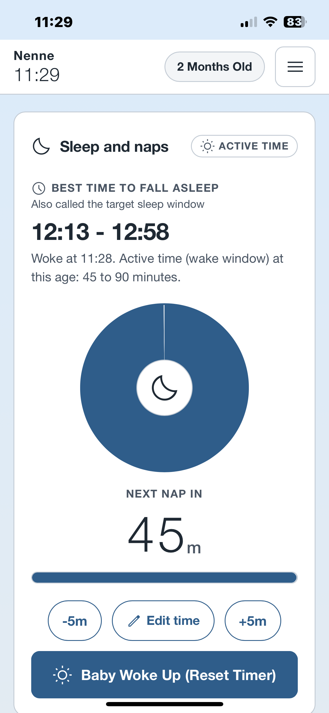
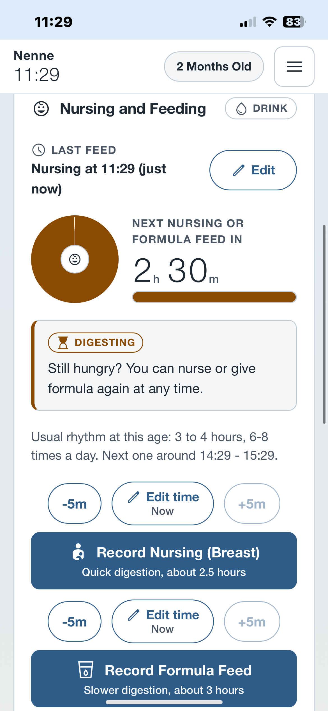
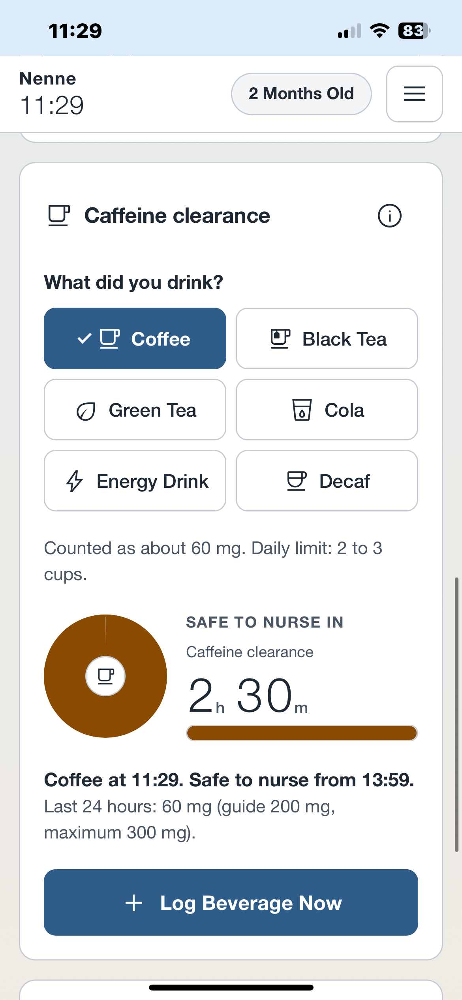
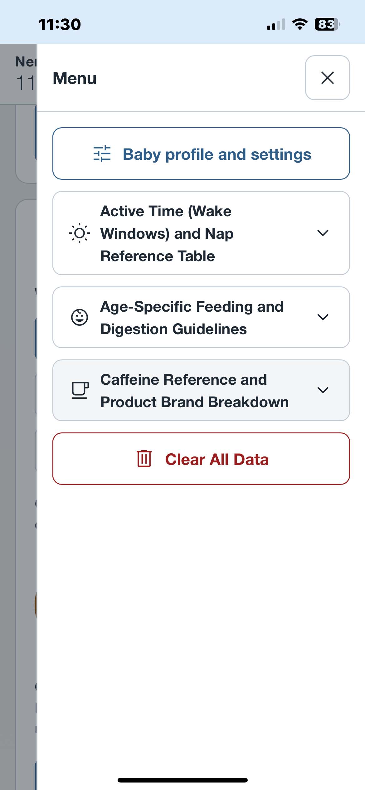
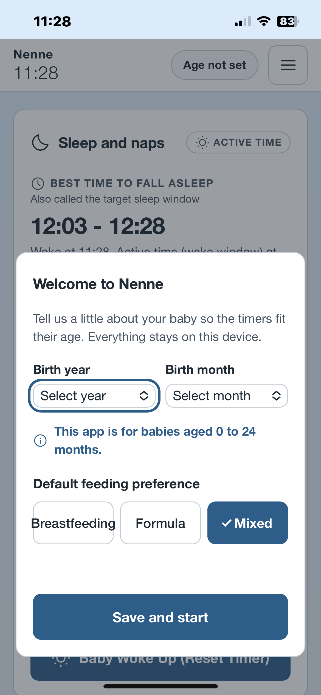
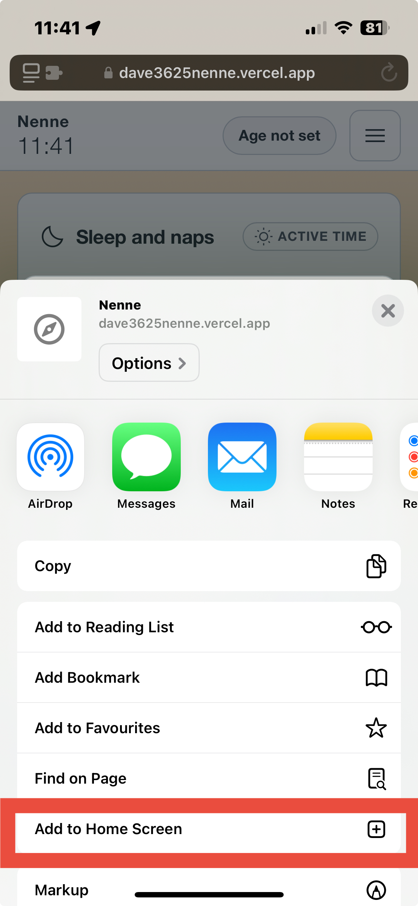
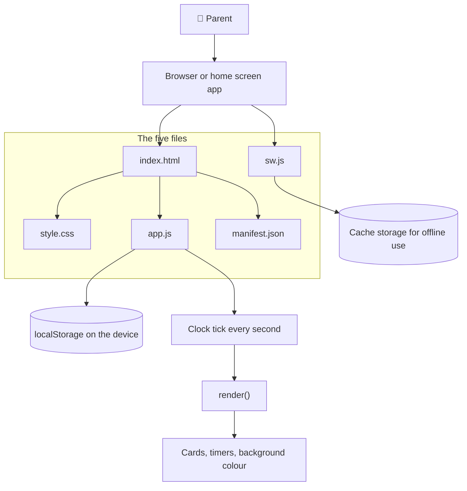
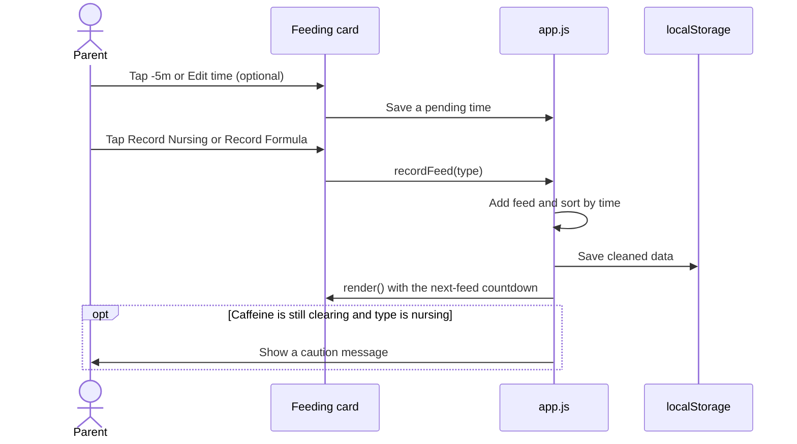

# Nenne

Nenne is a simple, offline-ready web app that helps parents track three everyday rhythms: **baby sleep, feeding, and caffeine intake while breastfeeding**.

Designed for babies aged 0–24 months, Nenne provides age-based reference guides and simple timers to make everyday routines easier to manage.

The name "Nenne" is a soft baby-talk word for sleep in Japanese. I chose it for its calm sound, because rest and rhythm are what this app is about.

**[Live Demo](https://dave3625nenne.vercel.app)**

## Features

- **Sleep & Naps** — Track wake times, view suggested sleep windows, and follow a live countdown. The background colour changes as nap time comes closer; Soft blue, soft orange and purple.
- **Nursing & Formula** — Record feeds, adjust timestamps, and see when the next feed may be due.
- **Caffeine Tracker** — Log common drinks and track estimated caffeine clearance and daily intake.
- **Reference Guides** — View age-specific sleep, feeding, and caffeine information.
- **Offline & Private** — Works offline after loading and stores all data locally on your device.
- **Mobile-Friendly** — Large touch targets, a calm interface, and optional home-screen installation.

## How to Use

1. Open Nenne and enter your baby's birth month, year, and usual feeding type.
2. Record wake-ups to see suggested sleep times and countdowns.
3. Record nursing or formula feeds, adjusting timestamps when needed.
4. Log caffeinated drinks to track estimated caffeine clearance.
5. Use the menu to view reference guides, update your profile, or clear your data.

You can optionally add Nenne to your phone's home screen for an app-like experience.

## Screenshots

| Sleep | Feeding |Caffeine |
|---|---|---|
|  | |  |

| Menu | Registration | Add to Home Screen |
|---|---|---|
|  |  |  |

## Privacy & Safety

- All app data is stored in the browser's `localStorage`. No app data is sent to a server.
- A service worker caches app files for offline use.
- Stored data is validated before use.
- All times use the device's local time zone and 24-hour format.

**Important:** Nenne provides general guidance, not medical advice. Sleep windows, feeding intervals, and caffeine estimates are not rules or guarantees. Every baby is different. Consult a healthcare professional if you have concerns about your baby's health, sleep, or feeding, or your caffeine intake while breastfeeding.

## Technology

Built with **HTML, CSS, and vanilla JavaScript**, without frameworks or build steps.

- `index.html` — Page structure
- `style.css` — Layout and visual design
- `app.js` — Timers, data, and application logic
- `manifest.json` — Progressive Web App (PWA) settings
- `sw.js` — Offline caching
- `icon.svg` — App icon

### Architecture

### What happens when you record a feed

---

## About the Project

Developed for the *DAVE3625 Introduction to AI* course at OsloMet in 2026, as part of the assignment **“Vibe Coding – Build Your Own App.”**

I built Nenne after becoming a parent and wanting one simple tool to answer three everyday questions:

- When should my baby sleep next?
- When did I last feed my baby?
- Can I have another caffeinated drink?

I wanted a simple, mobile-friendly solution that could be used with one hand.

### Building with AI

The app was developed with **Claude (Free Plan, Sonnet 5.5)**. I kept the implementation simple to make the generated code easier to understand and maintain.

The process involved three rounds of revisions, mainly to refine the interface, clarify instructions, and correct behavior.

### Reference Data Provided to the AI

I provided Claude with age-based guidelines and estimated caffeine values to build the app's reference tables and calculations.

#### Baby Sleep

| Age | Wake window | Typical naps |
|---|---|---|
| Under 1 month | 35–60 min | 4–5+ |
| 1–2 months | 45–90 min | 4–5 |
| 3–4 months | 75–120 min | 3–4 |
| 5–7 months | 120–180 min | 2–3 |
| 8–10 months | 150–210 min | 2 |
| 11–14 months | 180–240 min | 2 |
| 15–24 months | 240–360 min | 1 afternoon nap |

#### Feeding Guidelines

| Age | Suggested feeding pattern |
|---|---|
| 0–1 month | Every 2–3 hours; 8–12+ feeds/day |
| 2–3 months | Every 3–4 hours; 6–8 feeds/day |
| 4–5 months | About every 4 hours; 5–6 feeds/day |
| 6–8 months | About every 4 hours; around 5 feeds/day |
| 9–11 months | Every 4–5 hours; 4–5 feeds/day |
| 12–18 months | 1–2 feeds/day |
| 19–24 months+ | As needed for comfort |

The app uses estimated digestion times of **2.5 hours for breast milk** and **3 hours for formula**. These are guidelines only; feeding is never blocked by a timer.

#### Caffeine Reference Data

| Drink | Example brand | Reference serving | App value |
|---|---|---|---:|
| Coffee | Nescafé Gold Blend | 1 cup (2 g) | 60 mg |
| Black tea | Twinings Earl Grey | 1 tea bag | 40 mg |
| Green tea | Twinings Green Tea with Lemon | 1 tea bag | 25 mg |
| Cola | Coca-Cola | 330 ml | 33 mg |
| Energy drink | — | 250 ml | 110 mg |
| Decaf coffee | — | 1 serving | 5 mg |
| Water | — | Reference only | 0 mg |

### Calculation Logic

| Function | Rule used in the app |
|---|---|
| Next sleep time | Wake-up time + age-based wake window |
| Next-feed countdown | Last feed time + 2.5 hours (breast milk) or 3 hours (formula) |
| Caffeine total | Sum of the `mg` values for logged drinks |
| Caffeine clearance timer | 150 minutes (2.5 hours) |
| Daily caffeine guide | 200 mg guide; 300 mg maximum in the provided reference data |

These calculations use simplified estimates and do not guarantee medical outcomes or safety.

### Testing

- Testing was performed manually using Chrome and Safari to check the app's logic and layout.
- Installation on the home screen and offline functionality were also tested on a real iPhone.
- Testing on iPhone revealed a remaining issue with menu scrolling. (-> Future Improvements)

### What I Learned

- Clear, specific prompts are essential, but communicating visual intent through text alone is difficult.
- Planning the UI before coding can reduce unnecessary revisions.
- Testing on real devices is important, especially for mobile interactions and offline behavior.
- iOS home-screen icons may require a dedicated `apple-touch-icon` rather than a standard favicon.

### What I Would Do Differently Next Vibe-coding Session

- Plan before prompting: Think through the idea and design the UI before coding.

- Be specific: Use basic programming and design principles to keep the code understandable and maintainable. Write clear, precise prompts and provide visual prototypes when possible.

- Build incrementally: Add features one at a time with focused prompts.

- Expand testing across devices and browsers.

